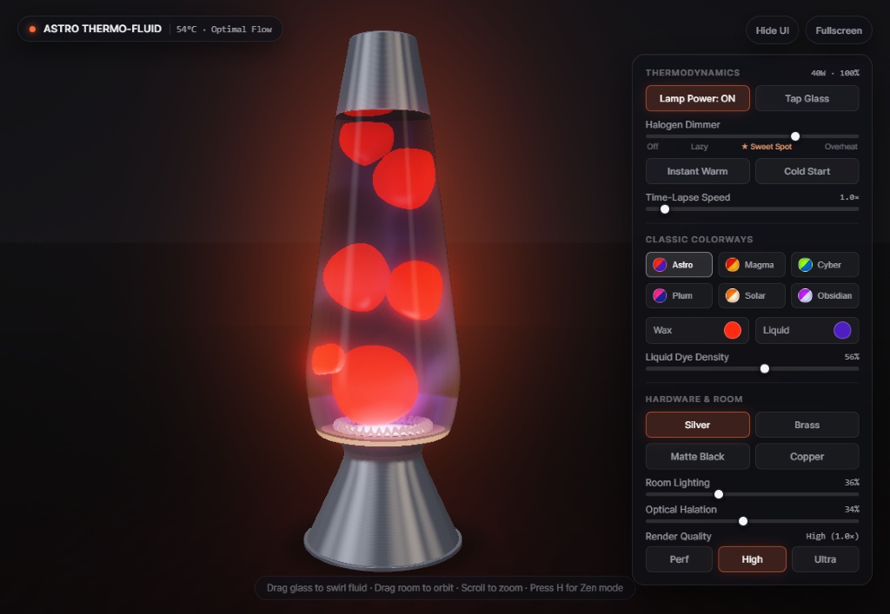

# Astro Physical Lava Lamp Simulation

A photorealistic 3D WebGL 2 lava lamp simulation running directly in the browser—zero external dependencies.

**Live Demo:** https://staylan488-ux.github.io/astro-lava-lamp/

## Features
- **Real Thermodynamics & Buoyancy:** Rayleigh-Bénard convection, Plateau-Rayleigh necking & satellite droplets, heating coil capillary pinning, and authentic **Cold Start** stalagmite warm-up physics.
- **8D Orthoplex Surfactant-Film Physics:** Rising warm blobs and sinking cool blobs deform and cushion against a thin carrier-fluid film as they pass each other, coalescing smoothly when the film drains.
- **3D Raymarched Optics:** Hybrid `80×192×80` `RGBA16F` 3D volume + exact analytical root/normal refinement, multi-channel Beer-Lambert subsurface scattering, total internal reflection on the top meniscus, 32-turn stainless steel coil, anisotropic brushed metal hardware, Dual-Kawase HDR bloom, and ACES filmic tonemapping.

## Controls
- **Drag glass globe:** Swirl fluid in 3D
- **Drag background / Scroll:** Orbit & zoom camera
- **`H` / `F` / `Space` / `T` / `C`:** Hide UI (Zen mode), Fullscreen, Pause, Tap glass, Cold Start
